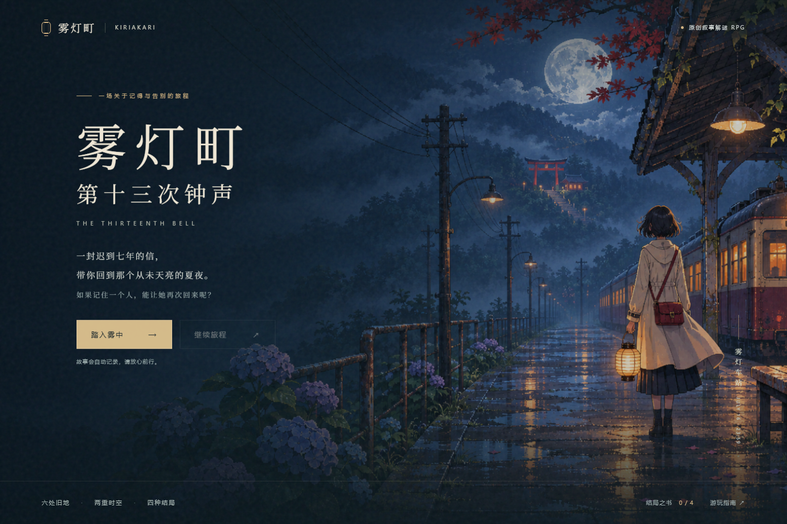
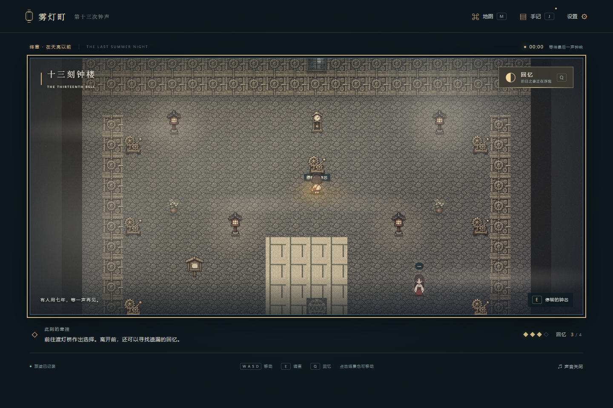

# 雾灯町：第十三次钟声

**KIRIAKARI · THE THIRTEENTH BELL**

[在线试玩](https://di3inep1.github.io/kiriakari/) · [GitHub 仓库](https://github.com/di3Inep1/kiriakari)

一封迟到七年的信，将澪带回被洪水吞没的小镇。这里永远停在灯见祭的前夜，姐姐栞的身影藏在钟声里。循着散落的回忆，决定究竟该留住昨日，还是走向天明。

原创中文**经典 2D 俯视解谜 RPG**，采用类似经典掌机 RPG 与日式房间解谜游戏的格子地图：逐格行走、墙体与家具碰撞、镜头跟随、门口切换、室内迷宫与邻格调查。可完整通关，包含序章、四个主线章节、终章与四种结局。玩法以探索、人物对话、双时空调查和机关推理为主，现有六处区域与两处可进入的室内。



## 开始游戏

在线版本直接打开上方试玩链接。更新 `main` 后，GitHub Actions 会检查游戏规则并自动部署到 GitHub Pages。可用 `npm run build` 在 `dist/` 生成静态发布文件；发布包只含游戏运行文件和美术资源。

在线与本地试玩使用不同的网站存档，浏览器不会自动把本地进度带到在线版本。

Windows：双击 **`start.bat`**。它会启动本地游戏并打开浏览器；游玩时保留启动窗口。

也可以在本目录运行：

```sh
npm start
```

浏览器访问 **http://127.0.0.1:4177**。需要 Node.js 18 或以上，无需安装依赖、无需构建、无需联网。端口已占用时可以直接打开上述地址；需要其他端口时设置 `PORT` 环境变量。

没有 Node.js 时，可直接双击 `index.html` 游玩；本地文件存档行为因浏览器而异，建议使用上面的固定地址，以便稳定续玩。

## 操作

| 操作 | 键位 / 方式 |
| --- | --- |
| 移动 | WASD / 方向键 / 点击地面 |
| 调查或交谈 | 靠近后 E / 点击人物或物件自动走近 |
| 继续对话、显示全文 | E / Enter / 对话框按钮 |
| 现世与回忆切换 | Q / 右上角时空按钮 |
| 手记、线索、回忆、约定 | J |
| 地图与快捷移动 | M |
| 关闭窗口 / 设置 | Esc |

手机和触屏设备支持点击移动及屏幕方向键。游戏提供三层递进提示，试错没有惩罚；引灯可无限次使用。

主角具有四方向的真实行走帧，会交替迈步，停下后恢复站姿。连续按住多个方向时，优先响应最近按下的方向；转向会平顺接在当前一步之后。点击寻路途中可以用方向键接管移动。

可调查物件带有细小的闪动十字光点，靠近或悬停时显示名称。已找回的回忆和已解开的机关会停止闪动。照片、手记与录音机分别放在长椅和书桌上，纸鹤悬挂在民居屋檐下。

取得引灯后，主角会提着木框纸灯，四个朝向具有不同的手部位置，行走时灯笼轻轻摆动，暖光落在脚边。回忆采用褪色旧照片般的色调、分层薄雾、细小颗粒和缓慢上升的光尘，灯周围会散开雾气。切换时光纹轻轻向外扩散。关闭漂浮光点仍保留照明，系统“减少动态效果”会关闭摆动与扩散动画。

石板砖缝按地图坐标连续铺设，跨越地图格子和镜头移动时保持对齐。灯、告示和家具使用透明图层，地面底色不会因摆放物件而变成另一块材质。

车站按轨道、站台安全线、站房与候车区、检票栏杆、出站步道排列。检票口在谜题解开前会实际阻挡通行，打开后可沿步道进入小镇。民居采用较低的屋身比例，纸鹤通过红线挂在右侧民居门旁的屋檐下，位置随建筑结构计算。更新布局后，旧存档会保留故事与收集进度，并将人物放回安全入口。

## 旅程中的内容

- **车站探索**：进站房，在矮柜取得熄灭的引灯；向莲借黄铜钥匙，去站台东端的维修箱找防潮火柴；回整灯台点灯、请莲挡风点灯，或在手记里使用火柴。值班簿、旧窗、长椅和寄物架均可调查。
- **制灯铺与修灯**：向凪婆婆了解修补方法，到东侧针线篮的回忆里找红线，在街南石井取水，到西侧制灯铺调开米糊，使用材料修好纸灯。婆婆会根据当前缺少的材料提供具体帮助，修好后教会神社的归舟歌。
- **迟到的包裹**：在站房接下旧包裹，交给灯见街的凪婆婆，获得送灯路线图与姐姐的补充往事。
- **道具与反馈**：材料会实际收集和消耗，手记显示随身物品与未完成请求。取走灯、红线、包裹后家具会变空，修好的灯会留在铺中。旧存档的已点灯、已修灯和结局进度保留。

两处室内按实际用途布置并收紧尺寸，家具统一按 1 × 1、2 × 1、3 × 1、1 × 3、2 × 2 等整格模块放置，显示、碰撞与调查点共享同一组坐标。站房新增储物柜、低橱柜、侧向屏风、盆栽、伞架、挂衣钩、路线板、挂画和成组障子窗；制灯铺保留方形工作台与储料区，补充窗户、图样板和盆栽。中央两格主通道保持连通，墙面采用室内油灯。车站与街道房屋外观同步缩小，门前道路与纸鹤挂点保持对应。详见 [室内布局记录](docs/INTERIOR-LAYOUT.md) 与 [整格家具记录及占地示意](docs/GRID-FURNITURE.md)。

- **六处区域、两处室内**：雾灯车站、灯见街、月见神社、旧校书库、十三刻钟楼、渡灯桥。
- **真正的地块地图**：使用 64 格 Image-gen 地块图集搭建，地图从 24 × 22 到 36 × 26 格；道路、建筑、书架、水面均有明确的通行判定。
- **经典移动**：四方向逐格移动，镜头跟随；点击物件时会寻找绕开障碍的路线，走近到相邻格再调查。
- **双重时空**：现世中的褪色文字，在回忆中重新显现；部分人物与物件只在回忆中出现。
- **四种机关**：日期密码、歌谣灯序、事件时间线、联动齿轮。
- **四段可收集回忆、三份人物约定**：了解姐姐被英雄叙事遮住的恐惧与愿望。
- **四种结局**：前三种在终章可自由选择；真结局需要补全回忆与约定，缺少的条件会清楚显示。
- **自动与手动存档**：切换场景、完成剧情与机关时自动保存，设置中也可手动保存和读取。
- **结局回溯**：看完结局后回到最后选择之前，补收集或查看其他结局；结局之书独立记录。
- **原创本地合成环境音乐**：首次默认关闭，可从游戏底栏或设置开启。

所有旧地均可重访，重要约定可以补做，不存在一次错选就无法达成真结局的情况。游戏采用单机浏览器存档，保存在当前浏览器、当前地址下；请勿清理网站数据。不同端口、浏览器或隐私窗口不共享进度。



## 美术

本轮场景完善新增 16 类透明植被素材：乔木、樱花、银杏、红枫、竹丛、垂柳、花簇、蕨类、芦苇、苔石和盆栽。各地采用不同的种植搭配；地面统一底纹、底色与砖缝，只在少量位置保留细小磨损、草苔边缘和落叶。树冠按位置遮挡人物，地图缩略图也同步显示这些细节。先期生成的 32 格地面变体留作原图记录，不在正式地图中混铺。

正式地图使用的 **8 × 8 地块图集**、标题插画、四角色头像和四方向角色图集，均通过**内置 image_gen** 生成。所有原始 PNG 都在 `assets/`，角色图集保留透明通道。先期生成的六场景概念图也保留在仓库。地图由地块实际拼接并配置碰撞，界面边框、谜题指针和环境光点由程序绘制。

生成提示词、图集排列与资源清单见 [素材记录](docs/ART-PROMPTS.md)。素材均保存在仓库内，运行时不请求远程图片或字体。

室内家具已全部换为格子版图集，旧柜架、行李、壁灯和墙钟另行重绘。所有家具保留图片原始比例，按整格边界等比显示；取灯、领取包裹和修灯时保持家具尺寸与位置稳定。见 [室内重绘素材与提示词](docs/GRID-INTERIOR-REDRAW.md)。

## 文件

| 文件 | 用途 |
| --- | --- |
| `index.html`、`style.css` | 游戏界面与响应式布局 |
| `game.js` | 探索、交互、剧情、机关与存档界面 |
| `maps.js` | 六张逐格地图、墙体碰撞、可通行区域与寻路 |
| `furniture.js` | 整格家具规格、完整矩形碰撞、朝向与状态 |
| `movement.js` | 连续步进、方向优先级、转向衔接与行走帧 |
| `scenery.js` | 分区地表、植物配置与稳定的装饰分布 |
| `world.js` | 2D 地块绘制、镜头跟随与地图缩略图 |
| `data.js` | 场景、人物、线索、回忆、结局文本 |
| `exploration.js` | 前两处区域的探索、道具说明与随进度变化的 NPC 帮助 |
| `lighting.js` | 提灯动作、光晕、回忆薄雾与颗粒效果 |
| `core.js` | 章节解锁、谜题验证、结局条件、存档恢复规则 |
| `audio.js` | 原创合成音乐与提示音 |
| `assets/` | Image-gen 正式美术资源 |
| `docs/STORY.md` | 完整故事设定与分支说明（含剧透） |
| `docs/WALKTHROUGH.md` | 通关攻略（含剧透） |
| `docs/QA.md` | 检查范围与验证记录 |

## 验证

```sh
npm test
```

核心测试不需要任何第三方依赖。浏览器完整通关测试可运行 `node tests/browser.cjs`，需要 Node.js 22+ 与 Windows Chrome/Edge；也可用 `CHROME_PATH` 指定浏览器。此测试会在临时浏览器配置中实际经过所有章节、四种结局、回溯、存档、声音与手机布局，并输出预览截图。

当前版本是完整的单机短篇；没有云存档、战斗系统、配音或商业引擎编辑器依赖。后续可直接扩写 `data.js` 与场景交互。
